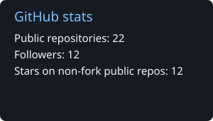
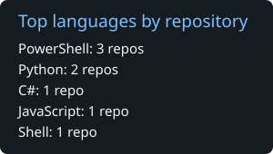

<!--
  Profile README for github.com/jasonmoodie
  Lives in the special public repo: jasonmoodie/jasonmoodie
  The stats cards in /profile are generated by .github/workflows/readme-cards.yml
-->

<div align="center">

# Hi, I'm Jason 👋


**Account Technology Strategist @ Microsoft** · Ottawa, Canada 🇨🇦 · English / Français

[](https://www.linkedin.com/in/jason-moodie-%F0%9F%A4%96-848891a/)
[](https://github.com/jasonmoodie)

</div>

---

## 🚀 About me

Day to day, I help Canadian enterprises rethink how their developers build software in the age of AI, pairing **GitHub Copilot** and **agentic DevOps** with the working practices that actually make them stick. I'm energized by the customers who go from *"what is this?"* to **shipping with agents in a matter of weeks**.

In my spare time I tinker with AI: experimenting across model providers and comparing how they reason, code and play together in agentic workflows. A few hours of prompt-tuning and side-by-side model bake-offs is my idea of a great stress release. Don't judge 🙂

## 🧾 `cat jason.json`

> Yes, my display name is **JSON**. Yes, it validates.

```json
{
  "name": "Jason Moodie",
  "aka": "JSON",
  "role": "Account Technology Strategist @ Microsoft",
  "location": "Ottawa, Canada 🇨🇦",
  "languages": ["English", "Français"],
  "favourite_tools": ["GitHub Copilot", "GitHub Actions", "Azure", "PowerShell", "Python"],
  "currently_tinkering_with": ["multi-agent orchestration", "Agent Skills", "MCP tools"],
  "stress_relief": "side-by-side model bake-offs",
  "fun_fact": "Built a school computer lab in Namibia 🇳🇦",
  "valid_json": true
}
```

## 🎯 Where I help teams

- **GitHub Copilot adoption that sticks:** rollout playbooks, hands-on enablement workshops and dashboards that show real usage
- **Agentic DevOps:** bringing coding agents, Agent Skills and MCP tools into everyday engineering workflows
- **Azure DevOps ⇄ GitHub:** GitHub Advanced Security for Azure DevOps, pipeline and agent-pool health, platform modernization
- **Cloud & app modernization:** Azure architecture, .NET migration and containerized apps
- **Responsible AI adoption:** governance, security posture and compliance for public sector teams

## 🛠️ Things I've built

#### 🤖 GitHub Copilot adoption & enablement

| Project | What it does | Built with |
| --- | --- | --- |
| [copilot-adoption-viewer-power-bi](https://github.com/jasonmoodie/copilot-adoption-viewer-power-bi) | Sample Power BI dashboard with user-level data to monitor GitHub Copilot adoption | Python · Power BI |
| [ADO-Skills](https://github.com/jasonmoodie/ADO-Skills) | Azure DevOps CLI skill for GitHub Copilot | Agent Skills · Azure DevOps CLI |
| [CopilotNetCalculator](https://github.com/jasonmoodie/CopilotNetCalculator) | Self-guided tutorial: learn GitHub Copilot by building a .NET calculator | C# · .NET |
| [Copilot-HTML-Calculator](https://github.com/jasonmoodie/Copilot-HTML-Calculator) | Workshop: learn GitHub Copilot with an HTML calculator | JavaScript · HTML |

#### 🛡️ Azure DevOps, security & platform insights

| Project | What it does | Built with |
| --- | --- | --- |
| [GHAzDO-Export](https://github.com/jasonmoodie/GHAzDO-Export) | Export and visualize GitHub Advanced Security for Azure DevOps alerts | PowerShell |
| [ADO-AgentPools-Analytics](https://github.com/jasonmoodie/ADO-AgentPools-Analytics) | Export Azure DevOps agent pool analytics to CSV | PowerShell |
| [ADO-Export-Deprecated-Tasks](https://github.com/jasonmoodie/ADO-Export-Deprecated-Tasks) | Experimental script that exports deprecated Azure DevOps tasks to JSON (naturally) | Python |
| [power-bi-fabric-workspace-details](https://github.com/jasonmoodie/power-bi-fabric-workspace-details) | Export your Microsoft Fabric and Power BI workspaces, plus a sample dashboard | PowerShell · Power BI |

## 🧪 Currently exploring

| Topic | Where I'm learning |
| --- | --- |
| Multi-agent orchestration | [skills-agent-orchestration-build-your-ai-dream-team](https://github.com/jasonmoodie/skills-agent-orchestration-build-your-ai-dream-team) |
| Agent Skills | [skills](https://github.com/jasonmoodie/skills) · [ADO-Skills](https://github.com/jasonmoodie/ADO-Skills) |
| MCP tools for GitHub Copilot | [snippy](https://github.com/jasonmoodie/snippy): Azure Functions, AI agents and Cosmos DB vector search |
| Enterprise RAG on Azure | [GPT-RAG](https://github.com/jasonmoodie/GPT-RAG) |
| App modernization with AI | [dotnet-migration-copilot-samples](https://github.com/jasonmoodie/dotnet-migration-copilot-samples) · [AKS_APP_Mod_Demo](https://github.com/jasonmoodie/AKS_APP_Mod_Demo) |
| Documents → Markdown for LLMs | [markitdown](https://github.com/jasonmoodie/markitdown) |
| Geospatial AI | [Earth-Copilot](https://github.com/jasonmoodie/Earth-Copilot) |

## 🧰 Toolbox

<p align="center">
  
</p>

<p align="center">
  
  
  
  
  
  
  
  
  
</p>

## 📊 GitHub stats

<!-- These two cards are generated daily by .github/workflows/readme-cards.yml. Run that workflow once by hand after your first commit. -->
<p align="center">
  
  
</p>

<details>
<summary><b>🧭 Path so far</b></summary>
<br />

- 🏛️ **Before Microsoft:** director-level roles leading technology transformation, cloud and IT strategy
- 🪟 **2022 · Joined Microsoft:** developer-focused customer success and Cloud Solution Architect roles (Apps & Innovation)
- 🎯 **2026 · Account Technology Strategist:** helping Canadian organizations build software in the age of AI

</details>

<details>
<summary><b>📜 Certifications & learning</b></summary>
<br />

- Microsoft Certified: Azure AI Fundamentals
- Microsoft Certified: Power Platform Fundamentals
- Microsoft 365 Certified: Fundamentals
- ITIL Foundation
- DevOps Foundations: DevSecOps · What Is Generative AI? · Introducing Semantic Kernel: Building AI-Based Apps
- Accessibility in Action (Microsoft)
- Microsoft Global Hackathon 2023

<!-- Add newer certifications here -->

</details>

## 🌱 Beyond the code

- 🇳🇦 In 2005 I took a sabbatical to volunteer in Namibia with VSO's NetCorps program, setting up a computer lab and teaching basic computer skills to students, teachers and the community at Tsumkwe Junior Secondary School.
- 🎖️ For more than four years, my son and I volunteered at the Perley and Rideau Veterans' Health Centre in Ottawa: visits, video calls and social activities.
- 🏁 Hackathon regular. All-time favourite team names: *Ship Happens*, *Prompt Patrol* and *Coffee-Driven Development*.

## 🤝 Let's connect

Want to talk GitHub Copilot rollouts, agentic DevOps or the best model for the job? Find me on [LinkedIn](https://www.linkedin.com/in/jason-moodie-%F0%9F%A4%96-848891a/).

<div align="center">
<sub>Built with ☕, GitHub Copilot and a healthy fear of malformed JSON.</sub>
</div>
